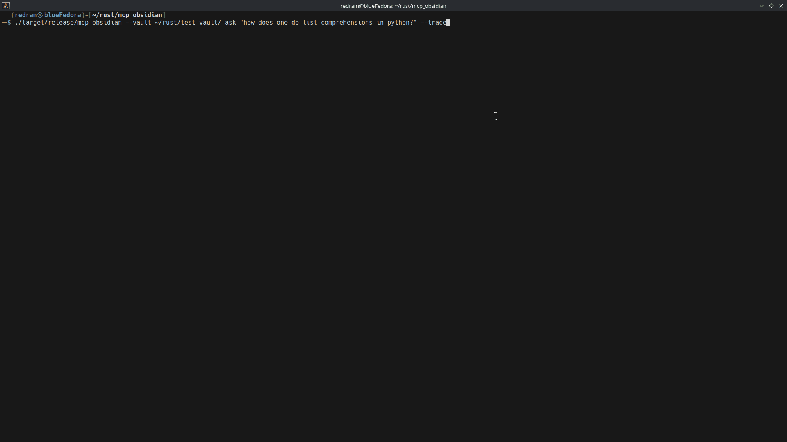
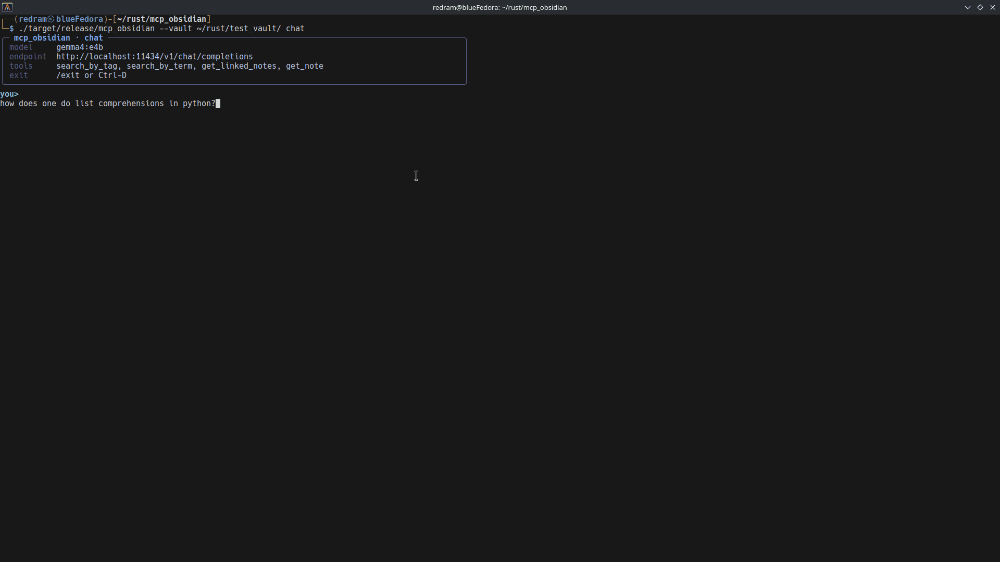
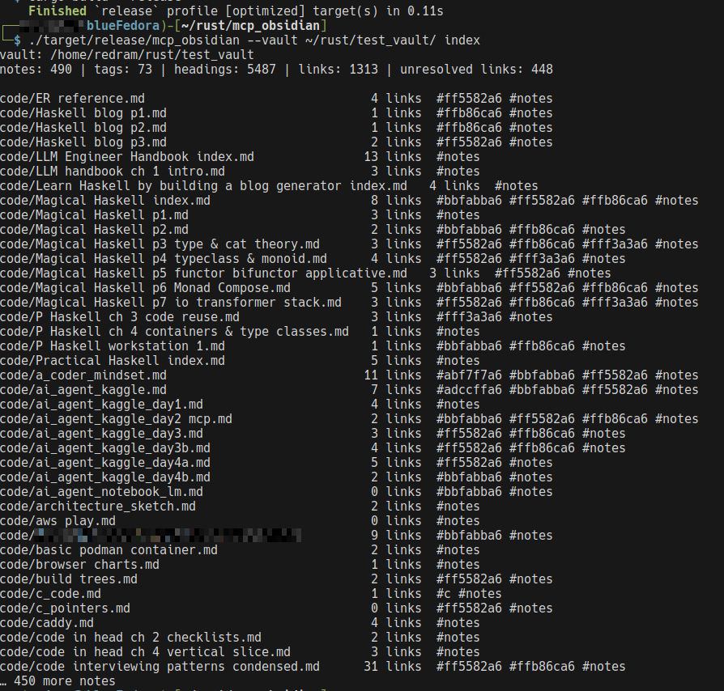
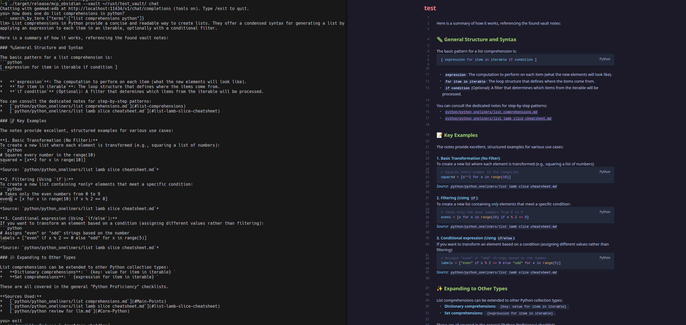
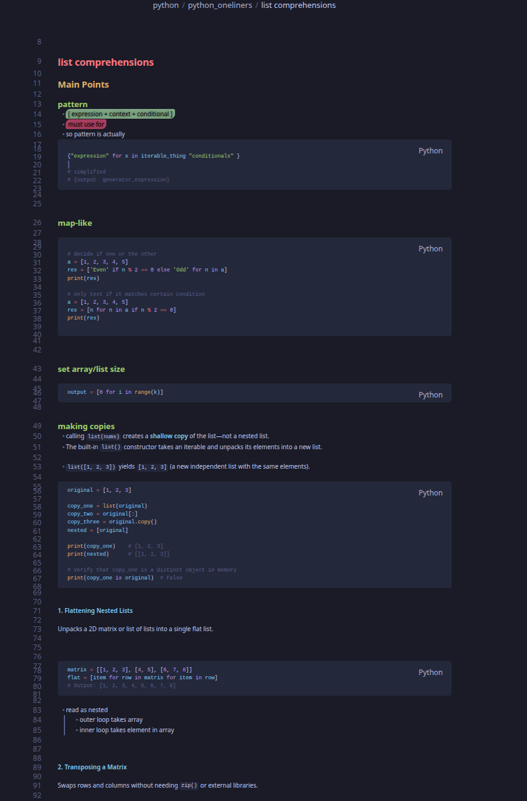

## MCP tool using obsidian

- going with the idea that it's better to search for local information using tags and search over RAG.
- more possible with the Open Knowledge Format (OKF) that Google is encouraging. Which mostly uses markdown.
- markdown, notes, and better access to local info makes me think there should be an app to connect an LLM to obsidian.

### Goals
- have tool check notes using: title, tags, and follow links in notes
- to have as a vault for llm to make notes. To solve problems, document it, and see if new problems are similar.


### Non-goals
- create a full GUI interface for the app
- to allow RAG use


## Demo

Everything below runs **locally on one desktop** — an NVIDIA **RTX 4060 Ti**
(16 GB) serving **`gemma4:e4b`** through Ollama, with the vault read from disk.
No API keys, no cloud calls, no data leaving the machine: the only network
traffic is `localhost:11434`.

### `ask` — one prompt, answered from the vault



### `chat` — the same loop, interactive



| Preview | What it shows |
| :- | :- |
|  | `index`: every note with its link count and tags, rendered as a table. |
|  | `chat`: the welcome panel, the tool trace and a markdown-rendered answer. |
|  | The vault material behind the Phase 3 exit criterion, `python/python_oneliners/list comprehensions.md`. |

### Fast, because this is a CLI and not a full-fledged TUI

`mcp_obsidian` **prints**, it does not **paint**. There is no alternate screen, no
event loop and no per-frame redraw: colours and layout are computed once per
answer with `richrs`, written to stdout, and the process exits. Measured on the
machine above:

| step | measured |
| :- | :- |
| index a 490-note vault (once, at startup) | ~60 ms |
| vault query (`search`, `index`, MCP tool call) | ~60 ms, no model involved |
| full `ask` round trip (pre-search + tool rounds + answer) | seconds — the local model is the only slow part |

A full-fledged TUI pays for a layout pass and a terminal repaint on every frame,
and a streaming chat UI adds one per token on top. Here the terminal does one
write per answer and the entire budget goes to the model, so retrieval feels
instant and the answer lands as soon as the GPU is done. It also keeps the output
an ordinary Unix stream: `ask "…" > answer.md`, `| grep`, `NO_COLOR=1` and
`FORCE_COLOR=1` all behave the way you expect.

## References
- https://cloud.google.com/blog/products/data-analytics/how-the-open-knowledge-format-can-improve-data-sharing/


## Status

Phase 1 complete (2026-09-28): the CLI can talk to Ollama and the tool set is
served over MCP.

Phase 2 complete (2026-10-01): the retrieval and Ollama layers are split into
small modules (`src/vault/`, `src/ollama_client/`) behind a library target, with
32 tests pinning the behaviour.

Phase 3 complete (2026-10-09): `ask` is grounded in the vault — an imperative
tool protocol plus a deterministic pre-search, so a model that never calls a
tool still gets the relevant notes. Output is rendered with `richrs` in a Tokyo
Night theme for `ask`, `chat`, `doctor`, `index`, `search` and `serve` (colours
auto-off when piping).

See `SUMMARY.md` for how it works and why, `ARCHITECTURE.md` for how to read the
code and where to change it, `logs/MCP_notes.md` for the implementation
comparison, and `TASKS.md` for what is done and what is next.

## Usage

```bash
cargo build --release

# vault-only commands (no model needed)
./target/release/mcp_obsidian --vault ~/vault index
./target/release/mcp_obsidian --vault ~/vault search tag project --match-all
./target/release/mcp_obsidian --vault ~/vault search term "token budget"
./target/release/mcp_obsidian --vault ~/vault search links index --depth 2
./target/release/mcp_obsidian --vault ~/vault search note projects/alpha

# with Ollama (defaults: http://localhost:11434/v1, gemma4:e4b)
./target/release/mcp_obsidian --vault ~/vault doctor
./target/release/mcp_obsidian --vault ~/vault ask "what do my notes say about token budgets?" --trace
./target/release/mcp_obsidian --vault ~/vault ask "…" --no-prefetch   # no pre-search, tools only
./target/release/mcp_obsidian --vault ~/vault chat

# as an MCP server for a desktop host
./target/release/mcp_obsidian --vault ~/vault serve
./target/release/mcp_obsidian --vault ~/vault serve -vv   # log each tool call to stderr
```

A ready-to-edit host configuration is in `claude_desktop_config.example.json`.
Environment variables `OBSIDIAN_VAULT`, `OLLAMA_URL`, `OLLAMA_MODEL` and
`RUST_LOG` override the defaults; `--api native` switches from
`/v1/chat/completions` to `/api/chat`. Colour is emitted only to a terminal:
`NO_COLOR=1` disables it, `FORCE_COLOR=1` forces it when piping.

Answers are word-wrapped to the terminal width, with continuation lines aligned
under the text instead of under the bullet. Redirected output is deliberately
**not** wrapped, so `ask "…" > answer.md` keeps the model's own line structure.

A sample vault lives in `samples/vault/` for trying the commands above.

## Tests

```bash
cargo test                            # vault + ollama client; no model needed
cargo test -- --ignored live_client   # needs a running Ollama with the model pulled
```

